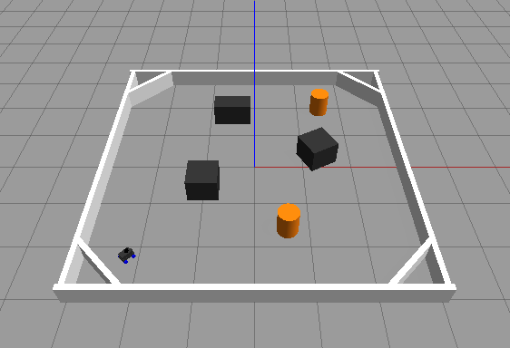

# ROSMASTER Crash Course

A 4-week ROS 2 crash course built around the **Yahboom ROSMASTER A1**, run at KAMAL Laboratory, Gunma University.

The goal: by Week 4 you understand how a robot like the ROSMASTER A1 maps a room, plans a path and drives to a goal by itself, and you can run the A1's built-in functions yourself.

| Week | Topic | What you do |
|---|---|---|
| 1 | ROS 2 Introduction | What ROS 2 is, nodes and topics, Gazebo. Run a simulated A1 that avoids obstacles with LiDAR. |
| 2 | Reading the Code | Linux, bash and Python basics. Read the Week 1 node line by line. |
| 3 | Control and Sensors | How the A1 moves (/cmd_vel, Ackermann steering, odometry) and what its sensors measure. LiDAR obstacle avoidance on the real A1. Homework: recognize objects with the A1's built-in YOLO. |
| 4 | ROSMASTER Functions | The A1's built-in functions from the Yahboom docs: SLAM mapping, Nav2 navigation, LiDAR follow/patrol, line following, color tracking, AI functions (object recognition, text or voice commands). |

Slides are in [`slides/`](slides/).



---

## Week 1: run the simulation

**What you will see:** Gazebo opens a 5 m x 5 m room with boxes and barrels. A model of the ROSMASTER A1 (with a LiDAR on top) drives around by itself and steers away from anything in front of it.

**What is running:**

```
 Gazebo (A1 + LiDAR)  --/scan-->  lidar_avoidance  --/cmd_vel-->  Gazebo (A1 wheels)
```

The node only reads `/scan` and writes `/cmd_vel`. The real A1 uses the same two topics, which is why the same node works on the real robot in Week 3.

### 0. Set up your PC (Windows, once)

You need **Ubuntu 22.04 + ROS 2 Humble + Gazebo 11**. On Windows we run Ubuntu inside **WSL2**. Gazebo windows show up on your Windows desktop (needs Windows 11, or Windows 10 build 19044 or later).

> Already on Ubuntu 22.04, or using a lab VNC container? Skip to step 0.3 or straight to step 1.

**0.1 Install Ubuntu 22.04 in WSL2.** Open **PowerShell as Administrator**:

```powershell
wsl --install -d Ubuntu-22.04
```

Restart the PC. Open **Ubuntu 22.04** from the Start menu and make a username and password (the password is hidden while you type, that is normal). Every command from here on goes in this Ubuntu terminal.

Optional but recommended: update your graphics driver (Intel, AMD or NVIDIA) on Windows so Gazebo runs smoothly.

**0.2 Add the ROS 2 package source** (from the [official Humble install guide](https://docs.ros.org/en/humble/Installation/Ubuntu-Install-Debs.html)):

```bash
sudo apt update && sudo apt upgrade -y
sudo apt install -y locales software-properties-common curl git
sudo locale-gen en_US en_US.UTF-8
sudo update-locale LC_ALL=en_US.UTF-8 LANG=en_US.UTF-8
export LANG=en_US.UTF-8
sudo add-apt-repository -y universe

export ROS_APT_SOURCE_VERSION=$(curl -s https://api.github.com/repos/ros-infrastructure/ros-apt-source/releases/latest | grep -F "tag_name" | awk -F'"' '{print $4}')
curl -L -o /tmp/ros2-apt-source.deb "https://github.com/ros-infrastructure/ros-apt-source/releases/download/${ROS_APT_SOURCE_VERSION}/ros2-apt-source_${ROS_APT_SOURCE_VERSION}.$(. /etc/os-release && echo ${UBUNTU_CODENAME:-${VERSION_CODENAME}})_all.deb"
sudo dpkg -i /tmp/ros2-apt-source.deb
```

**0.3 Install ROS 2 Humble, Gazebo and the tools.** This downloads a few GB and takes a while.

```bash
sudo apt update && sudo apt upgrade -y
sudo apt install -y ros-humble-desktop ros-dev-tools \
  ros-humble-gazebo-ros-pkgs ros-humble-xacro ros-humble-teleop-twist-keyboard git
```

**0.4 Load ROS 2 in every new terminal:**

```bash
echo "source /opt/ros/humble/setup.bash" >> ~/.bashrc
source ~/.bashrc
```

**0.5 Check it works.** Terminal 1: `ros2 run demo_nodes_cpp talker`. Terminal 2: `ros2 run demo_nodes_py listener`. If the listener prints "I heard...", ROS 2 is working. Press `Ctrl+C` in both.

**0.6 Check Gazebo.** Run `gazebo`. An empty world should open on your Windows desktop (first start is slow). Close it. If the window is black or Gazebo crashes:

```bash
echo "export LIBGL_ALWAYS_SOFTWARE=1" >> ~/.bashrc
source ~/.bashrc
```

### 1. Get the code

```bash
mkdir -p ~/rosmaster_ws/src && cd ~/rosmaster_ws/src
git clone https://github.com/Phearamony/ROSMASTER_crash_course.git
```

`mkdir -p` makes the workspace and its `src/` folder. `git clone` downloads this repo into `src/`.

### 2. Build it

```bash
cd ~/rosmaster_ws && colcon build --symlink-install
source install/setup.bash
```

`colcon build` turns the packages into programs inside `install/`. `--symlink-install` links your Python files, so if you edit the node you do not need to rebuild. `source install/setup.bash` tells this terminal where the programs are. **Every new terminal needs this source line.** (Tip: `echo "source ~/rosmaster_ws/install/setup.bash" >> ~/.bashrc` does it for you.)

### 3. Terminal 1: open Gazebo with the A1

```bash
ros2 launch rosmaster_sim sim.launch.py
```

This starts Gazebo with the obstacle room, loads the A1 model (`urdf/rosmaster_a1.urdf.xacro`), and spawns it in the corner. The first start can take 30 seconds or more. The robot sits still: it is publishing `/scan` and waiting for `/cmd_vel`.

### 4. Terminal 2: start the brain

```bash
source ~/rosmaster_ws/install/setup.bash
ros2 run rosmaster_avoidance lidar_avoidance
```

The robot starts driving. The terminal prints what it decides:

```
FORWARD    front=2.31 left=1.05 right=0.88
TURN RIGHT front=0.64 left=0.52 right=1.40
```

### 5. Check it with ROS 2 tools (Terminal 3)

```bash
ros2 node list               # see /lidar_avoidance ?
ros2 topic list              # see /scan and /cmd_vel ?
ros2 topic echo /cmd_vel     # the speed commands our node sends
ros2 topic hz /scan          # about 10 messages per second
rqt_graph                    # draw the node graph
```

---

## How the node works

File: [`src/rosmaster_avoidance/rosmaster_avoidance/lidar_avoidance.py`](src/rosmaster_avoidance/rosmaster_avoidance/lidar_avoidance.py)

1. **Listen and talk.** Subscribes to `/scan` (`sensor_msgs/LaserScan`) and publishes `/cmd_vel` (`geometry_msgs/Twist`). ROS 2 calls `scan_callback` every time a scan arrives (about 10 times per second).
2. **Look.** It splits the 360 LiDAR distances into three zones and keeps the closest distance in each. 0° is straight ahead, positive angles are to the left.

   | Zone | Angles |
   |---|---|
   | front | -25° to 25° |
   | left | 25° to 90° |
   | right | -90° to -25° |

3. **Decide.** Three rules:
   1. Front is clear: drive forward.
   2. Front is blocked (closer than `safe_distance`): slow down and steer toward the side with more space.
   3. Too close (closer than `stop_distance`): back up for about 1.5 s, then try again. The A1 steers like a car, so it cannot spin in place.
4. **Act.** It fills a `Twist` message (`linear.x` = forward speed in m/s, `angular.z` = turning, positive = left) and publishes it.

### Parameters

| Name | Default | Meaning |
|---|---|---|
| `forward_speed` | 0.25 | Driving speed (m/s) |
| `turn_speed` | 1.0 | How hard to turn |
| `safe_distance` | 0.7 | Start turning when something is closer than this (m) |
| `stop_distance` | 0.3 | Back up when something is closer than this (m) |

Change them without editing code:

```bash
ros2 run rosmaster_avoidance lidar_avoidance --ros-args -p safe_distance:=1.0 -p forward_speed:=0.15
```

---

## Week 1 experiments

1. **Drive it yourself.** Stop the avoidance node (`Ctrl+C`), then run `ros2 run teleop_twist_keyboard teleop_twist_keyboard`. Keep that terminal selected and use `i`, `j`, `l`, `,` to drive. `k` stops.
2. **Look at the data.** Drive next to a box and run `ros2 topic echo /scan --once`. Find the small numbers in `ranges`.
3. **Change its behavior.** Try `safe_distance:=0.4` and `safe_distance:=1.0`. Which one hits things? Which one gets stuck?
4. **Make it harder.** In Gazebo, use the box and cylinder tools on the top toolbar to drop new obstacles. Does the robot still escape?

---

## Repo layout

```
ROSMASTER_crash_course/
├── slides/                       weekly slides (PDF)
└── src/
    ├── rosmaster_sim/            package: robot model + world + launch file
    │   ├── launch/sim.launch.py
    │   ├── urdf/rosmaster_a1.urdf.xacro
    │   └── worlds/obstacle_room.world
    └── rosmaster_avoidance/      package: our Python node
        ├── package.xml           name, version, dependencies
        ├── setup.py              registers the lidar_avoidance node
        └── rosmaster_avoidance/lidar_avoidance.py
```

---

## Troubleshooting

| Problem | Fix |
|---|---|
| `Package 'rosmaster_sim' not found` | You did not source. Run `source ~/rosmaster_ws/install/setup.bash` in that terminal. |
| Gazebo window is black or crashes in WSL | Run `export LIBGL_ALWAYS_SOFTWARE=1` in that terminal, then launch again. Updating the Windows graphics driver also helps. |
| Gazebo takes very long the first time | Normal. It is loading models. Wait, or close and launch again. |
| `gzserver: Address already in use` / Gazebo will not start | An old Gazebo is still running. Run `killall gzserver gzclient`, then launch again. |
| Robot does not move | Is the avoidance node running in another terminal? Check `rqt_graph`: `/cmd_vel` must connect `/lidar_avoidance` to Gazebo. |
| Robot moves when you did not run anything, or two robots fight | Someone on the same network uses the same ROS ID. Pick your own number: `export ROS_DOMAIN_ID=<your number 1-100>` in every terminal. |
| `colcon: command not found` | `sudo apt install ros-dev-tools` |

---

## About the robot model

`rosmaster_a1.urdf.xacro` is a simplified model made of boxes and cylinders, sized like the real A1 (about 28 x 20 x 18 cm, 68 mm wheels, 16 cm wheelbase). It uses Gazebo's Ackermann drive plugin, so it steers with its front wheels like the real robot and cannot turn in place. The LiDAR gives 360 readings per scan at 10 Hz, from 0.12 m to 8 m.

Yahboom's own A1 model (with real meshes) lives on the robot in `yahboomcar_description`. We use it in Week 3.

Tested with ROS 2 Humble and Gazebo Classic 11. Gazebo Classic reached end of life in January 2025; it is still what ships with Humble, which is what the A1 runs.
